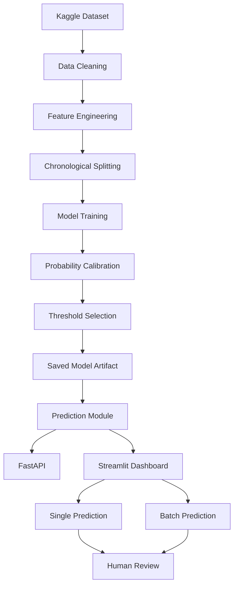

# 🏥 Hospital Appointment No-Show Prediction

**An End-to-End Machine Learning Decision-Support System for Predicting Hospital Appointment No-Shows**

Predicts the probability that a **booked hospital appointment will be missed**, helping front-desk staff prioritize supportive, human-reviewed reminder calls.

It does not predict diagnosis, urgency, severity, or clinical outcomes.

<p align="center">

[🚀 Live Streamlit Dashboard](https://hospital-appointment-no-show-prediction-sk.streamlit.app/) | [📂 GitHub Repository](https://github.com/shivam-9s/hospital-appointment-no-show-prediction)

</p>

---

## 1. Project Overview

Hospital appointment no-shows can affect scheduling efficiency, resource utilization, and patient access to healthcare services.

This project develops an end-to-end machine learning pipeline to estimate the probability that a scheduled appointment will result in a no-show.

The system supports human-reviewed reminder prioritization through individual predictions, batch scoring, risk categorization, and model explanations.

### Problem Definition

| Component | Description |
|---|---|
| Business decision | Which booked appointments should be considered for a reminder call or SMS? |
| Prediction unit | One scheduled appointment |
| Prediction time | At booking time (`ScheduledDay`) |
| Prediction horizon | Appointment date, 0–179 days after booking |
| Target variable | `no_show = 1` if the patient did not attend |
| Data splitting | Chronological by appointment date |
| Models evaluated | Baselines, Logistic Regression, Random Forest, HistGradientBoosting |
| Selected model | HistGradientBoosting |
| Interface | FastAPI + Streamlit |
| Human oversight | Every flagged appointment requires human review |

### Key Features

- Individual appointment no-show probability prediction.
- Batch prediction through CSV uploads.
- Ranked appointment review queue.
- Five-level risk categorization.
- Probability calibration.
- Cost-based decision threshold.
- Model explanations using reference-perturbation estimates.
- Input validation and warnings.
- FastAPI prediction endpoints.
- Interactive Streamlit dashboard.
- Automated tests for data leakage, model behaviour, and API functionality.

---

## 2. Live Application

**Try the deployed application:**

[Hospital Appointment No-Show Prediction – Streamlit Cloud](https://hospital-appointment-no-show-prediction-sk.streamlit.app/)

The dashboard contains three sections:

| Dashboard Section | Functionality |
|---|---|
| Single Appointment | Enter appointment details and calculate no-show probability |
| Batch Review Queue | Upload CSV records, score appointments, and rank them by estimated risk |
| Model & Safeguards | Explore model metadata, evaluation metrics, risk bands, and limitations |

### Dashboard Preview

Add your actual screenshots to `docs/images/` and use the following Markdown:

```markdown
### Single Appointment Prediction


### Batch Review Queue


### Model Evaluation and Safeguards


```

---

## 3. Dataset

**Source:** Kaggle – Medical Appointment No Shows

Dataset: [Medical Appointment No Shows](https://www.kaggle.com/datasets/joniarroba/noshowappointments)

| Property | Description |
|---|---|
| Dataset identifier | `joniarroba/noshowappointments` |
| Original records | 110,527 |
| Location | Vitória, Brazil |
| Collection period | April–June 2016 |
| Target | No-show outcome |
| Task | Binary classification |

### Dataset Setup

Download and unzip the Kaggle dataset.

Place the CSV file inside:

```text
data/raw/
```

Any supported CSV filename can be used, for example:

```text
KaggleV2-May-2016.csv
```

or:

```text
noshowappointments-kagglev2-may-2016.csv
```

The raw dataset is excluded from Git using `.gitignore`.

If the Kaggle dataset is unavailable, the pipeline supports a schema-identical synthetic data generator:

```text
src/noshow/data_generator.py
```

**Important:** Reported model metrics are based on the real Kaggle dataset, not synthetic fallback data.

Check the dataset's licence on Kaggle before redistributing it.

---

## 4. Data Preparation and Leakage Prevention

The model uses information available at booking time to prevent future information from influencing predictions.

### Data Cleaning

The preprocessing pipeline:

- Removes invalid ages below 0 or above 110.
- Removes appointments dated before their booking dates.
- Excludes clinical columns such as `Hipertension`, `Diabetes`, `Alcoholism`, and `Handcap`.
- Excludes `SMS_received`, which represents post-booking information.
- Builds historical attendance features using only outcomes known before the current booking.

### Feature Engineering

Important model features include:

- Age
- Booking lead time
- Log-transformed lead time
- Scheduled hour
- Previous appointments
- Previous no-shows
- Historical no-show rate
- Days since last appointment
- Scholarship indicator
- Same-day booking indicator
- Appointment weekday
- Scheduled weekday
- Neighbourhood

### Chronological Data Splitting

The dataset is divided chronologically by appointment date.

| Dataset | Proportion |
|---|---:|
| Training | 60% |
| Validation | 20% |
| Testing | 20% |

The most recent appointment dates are reserved for testing.

The pipeline also includes checks to ensure future appointment outcomes do not influence current features.

---

## 5. Exploratory Data Analysis and Model Training

The project compares simple baseline strategies with multiple machine learning algorithms.

### Models Evaluated

1. Never-flag baseline
2. Flag-everyone baseline
3. Lead-time rule baseline
4. Logistic Regression
5. Random Forest
6. HistGradientBoosting

**Selected model: HistGradientBoosting**

The selected model uses engineered appointment features to estimate the probability of a no-show.

### Training Configuration

| Parameter | Value |
|---|---:|
| Algorithm | HistGradientBoosting |
| Learning rate | 0.03 |
| Maximum depth | 3 |
| Maximum iterations | 300 |
| Random seed | 42 |
| Training samples | 63,529 |
| Validation samples | 20,538 |
| Test samples | 26,449 |

### Class Imbalance and Calibration

The pipeline uses class-imbalance handling, probability calibration, and a cost-based decision threshold.

The selected threshold is approximately **0.17505 (17.5%)**.

The project's illustrative cost assumptions are:

- False positive cost: 1
- False negative cost: 4

These are modelling assumptions, not real hospital financial estimates.

---

## 6. Model Evaluation

The following results are from the held-out test evaluation.

### Performance Metrics

| Metric | Result |
|---|---:|
| ROC-AUC | **0.7291** |
| PR-AUC | **0.3296** |
| Precision | 0.2744 |
| Recall | **0.8689** |
| F1-score | 0.4171 |
| Calibrated Brier Score | 0.1359 |
| Raw Brier Score | 0.2163 |
| Review Threshold | 17.505% |

### Confusion Matrix

| Actual / Predicted | No-show | Show |
|---|---:|---:|
| Actual No-show | 4,242 | 640 |
| Actual Show | 11,216 | 10,351 |

### Cost-Based Threshold

The threshold is selected using the assumed relative costs of false positives and false negatives.

It determines which appointments are flagged for staff review.

A flagged prediction does not authorize an automatic reminder or any change to patient care.

### Risk Categorization

The dashboard categorizes predicted probabilities into five risk bands.

| Risk Band | Probability Range |
|---|---|
| Very Low | 0–10% |
| Low | 10–20% |
| Medium | 20–30% |
| High | 30–45% |
| Very High | 45–100% |

The dashboard also displays historically observed validation no-show rates for these risk bands.

---

## 7. System Architecture

The project separates data preparation, model training, inference, API functionality, and dashboard presentation.



### Prediction Workflow

1. Receive appointment information.
2. Validate the input.
3. Generate engineered features.
4. Load the trained model artifact.
5. Calculate the no-show probability.
6. Assign a risk band.
7. Compare the probability against the review threshold.
8. Display relevant explanations and warnings.
9. Require human review.

---

## 8. Technology Stack

| Category | Technologies |
|---|---|
| Programming Language | Python |
| Data Processing | Pandas, NumPy |
| Machine Learning | Scikit-learn |
| Visualization | Matplotlib |
| Model Persistence | Joblib |
| Backend API | FastAPI |
| Interactive Dashboard | Streamlit |
| API Testing | HTTPX |
| Automated Testing | Pytest |
| Version Control | Git, GitHub |
| Deployment | Streamlit Community Cloud |

---

## 9. Repository Structure

```text
hospital-appointment-no-show-prediction/
│
├── dashboard/
│   └── streamlit_app.py
│
├── src/
│   └── noshow/
│       ├── __init__.py
│       ├── config.py
│       ├── data_generator.py
│       ├── data_prep.py
│       ├── features.py
│       ├── train.py
│       ├── eda.py
│       ├── predict.py
│       └── api.py
│
├── data/
│   ├── raw/
│   └── processed/
│
├── models/
│   └── noshow_model.joblib
│
├── reports/
│
├── tests/
│   ├── test_data_and_leakage.py
│   └── test_model_and_api.py
│
├── scripts/
│   └── make_sample_bookings.py
│
├── notebooks/
│
├── requirements.txt
├── .gitignore
└── README.md
```

This is a representation of the main components. Check the repository for any additional files before treating it as an exhaustive directory listing.

---

## 10. Installation and Setup

### Step 1: Clone the Repository

```bash
git clone https://github.com/shivam-9s/hospital-appointment-no-show-prediction.git

cd hospital-appointment-no-show-prediction
```

### Step 2: Create a Virtual Environment

```bash
python -m venv .venv
```

Activate on Windows PowerShell:

```powershell
.venv\Scripts\Activate.ps1
```

Activate on Linux/macOS:

```bash
source .venv/bin/activate
```

### Step 3: Install Dependencies

```bash
python -m pip install --upgrade pip

pip install -r requirements.txt
```

The project uses pinned versions for model compatibility.

### Step 4: Configure Python Path

Windows PowerShell:

```powershell
$env:PYTHONPATH="src"
```

Linux/macOS:

```bash
export PYTHONPATH=src
```

### Step 5: Run the Streamlit Dashboard

```bash
streamlit run dashboard/streamlit_app.py
```

Open the local URL provided by Streamlit, usually:

```text
http://localhost:8501
```

**Model artifact requirement:** The saved artifact must be available at `models/noshow_model.joblib`. If you retrain the model, use the project's compatible environment and update the artifact accordingly.

---

## 11. Data Preparation and Training Commands

If the Kaggle CSV is available, place it in `data/raw/`.

Optional synthetic data generation:

```bash
python -m noshow.data_generator
```

Prepare the dataset:

```bash
python -m noshow.data_prep
```

Run exploratory data analysis:

```bash
python -m noshow.eda
```

Train and evaluate the model:

```bash
python -m noshow.train
```

Generate sample bookings for batch prediction:

```bash
python scripts/make_sample_bookings.py
```

These commands assume the corresponding modules and scripts are present in your checkout.

---

## 12. FastAPI Prediction Service

The project includes a separate FastAPI service.

API module:

```text
src/noshow/api.py
```

Prediction module:

```text
src/noshow/predict.py
```

Start the API:

```bash
python -m uvicorn noshow.api:app --host 127.0.0.1 --port 8000
```

Interactive API documentation:

```text
http://127.0.0.1:8000/docs
```

### API Endpoints

| Endpoint | Method | Purpose |
|---|---|---|
| `/predict` | POST | Predict an individual appointment |
| `/predict/batch` | POST | Predict multiple appointments |
| `/model-info` | GET | Retrieve model information |

Example individual prediction request:

```json
{
  "booking_datetime": "2016-06-01T09:30:00",
  "appointment_date": "2016-06-20",
  "age": 24,
  "neighbourhood": "JARDIM CAMBURI",
  "scholarship": true,
  "prior_appointments": 3,
  "prior_no_shows": 2,
  "days_since_last_appointment": 12
}
```

The prediction layer provides probabilities, risk bands, review flags, explanations, and input warnings.

**Deployment architecture:** The deployed Streamlit dashboard calls the prediction module directly. It does not require a separate FastAPI server to be running. FastAPI remains available for independent API demonstrations.

---

## 13. Automated Testing

The project includes tests for data processing, leakage prevention, model behaviour, API functionality, and input validation.

Run the complete test suite:

```powershell
$env:PYTHONPATH="src"
python -m pytest -v
```

### Latest Test Results

| Test Category | Status |
|---|---|
| Data cleaning | Passed |
| Feature leakage prevention | Passed |
| Chronological splitting | Passed |
| Model artifact validation | Passed |
| Train-serve consistency | Passed |
| Prediction endpoints | Passed |
| Input validation | Passed |
| Batch ranking | Passed |
| Timezone handling | Passed |

**Latest result: 25 passed, 0 failed.**

---

## 14. Deployment

The interactive dashboard is deployed using Streamlit Community Cloud.

**Live URL:**

https://hospital-appointment-no-show-prediction-sk.streamlit.app/

### Deployment Environment

| Component | Version |
|---|---|
| Python | 3.12.16 |
| scikit-learn | 1.7.2 |
| NumPy | 2.2.6 |
| Pandas | 2.3.3 |
| SciPy | 1.15.3 |
| Joblib | 1.6.0 |

The model artifact was trained using Python 3.10.11 and scikit-learn 1.7.2. The deployed environment uses scikit-learn 1.7.2 to maintain compatibility with the saved artifact.

---

## 15. Responsible Use and Limitations

This project is an educational and research-oriented portfolio prototype.

- Predictions are not diagnoses or measures of clinical need.
- The system does not automatically send reminders.
- Every flagged appointment requires human review.
- Never cancel, double-book, overbook, or deprioritize care based on a prediction.
- Historical data comes from public hospitals in Vitória, Brazil, in 2016.
- The dataset may not represent another hospital or current patient population.
- Neighbourhood and scholarship variables may act as socioeconomic proxies and require fairness monitoring.
- The API and dashboard do not provide authentication or audit logging.
- Do not upload real patient data.
- Cost assumptions are illustrative and should be replaced with locally validated estimates before any real-world evaluation.

---

## 16. Key Learning Outcomes

This project provided practical experience with:

- End-to-end machine learning development.
- Data cleaning and exploratory data analysis.
- Feature engineering.
- Chronological train-validation-test splitting.
- Prevention of data leakage.
- Handling class imbalance.
- Gradient boosting classification.
- Probability calibration.
- Cost-based threshold selection.
- Model evaluation and interpretation.
- REST API development using FastAPI.
- Interactive dashboard development using Streamlit.
- Batch inference and risk ranking.
- Automated testing using Pytest.
- GitHub version control and cloud deployment.

---

## 17. Author

**Shivam Kumar**

B.Tech Computer Science and Engineering Student

- GitHub: [@shivam-9s](https://github.com/shivam-9s)
- Repository: [Hospital Appointment No-Show Prediction](https://github.com/shivam-9s/hospital-appointment-no-show-prediction)
- Live Application: [Streamlit Dashboard](https://hospital-appointment-no-show-prediction-sk.streamlit.app/)

---

⭐ If you find this project interesting, consider giving the repository a star!

*Built as an end-to-end machine learning research and portfolio project.*