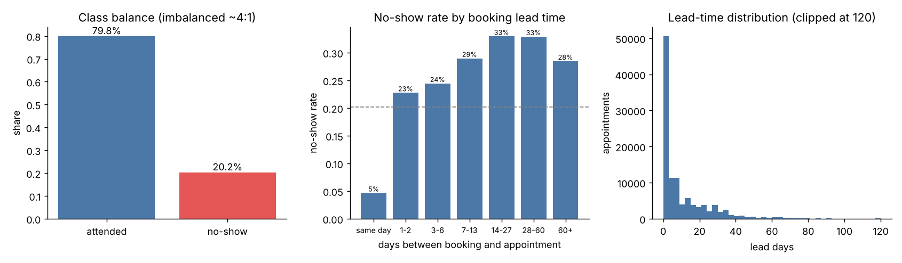
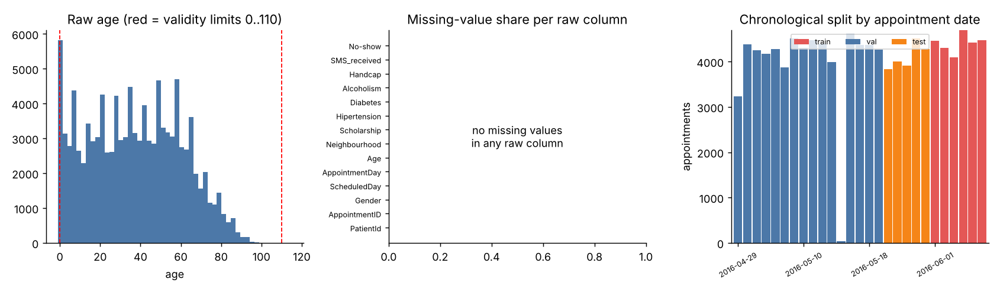
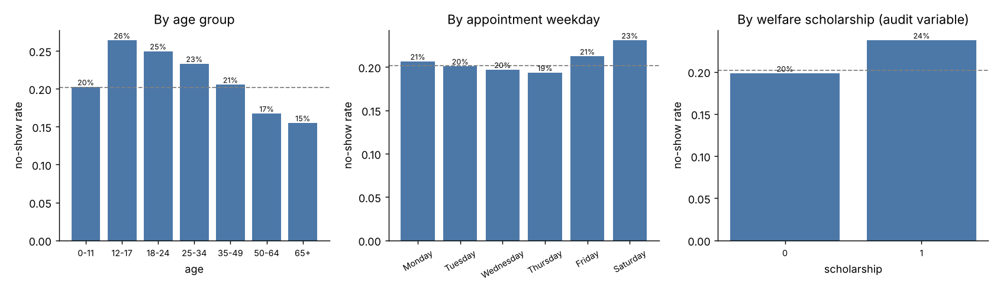
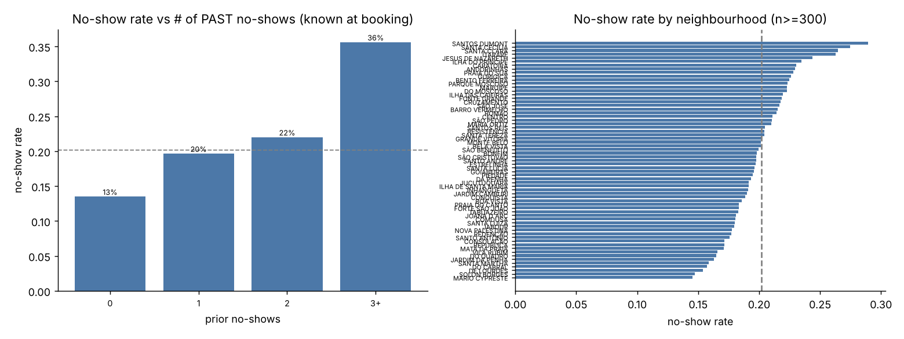
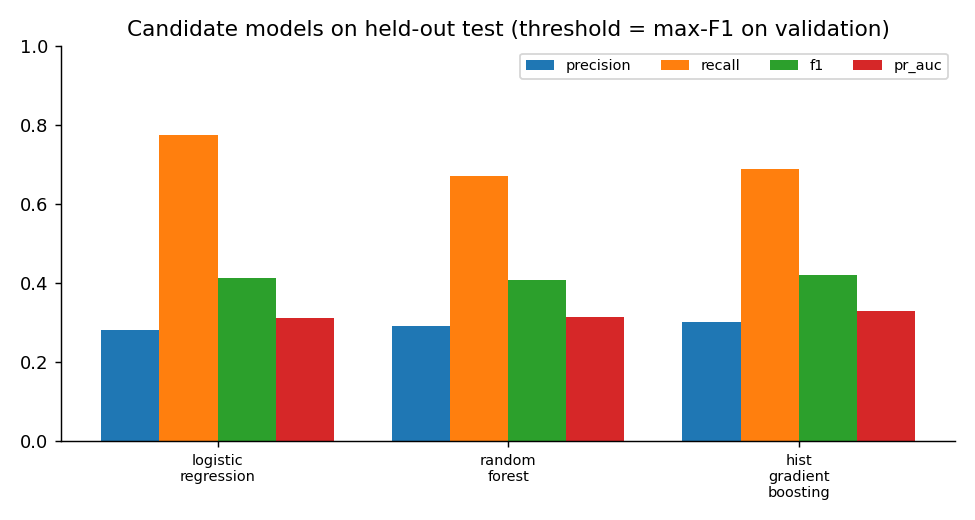
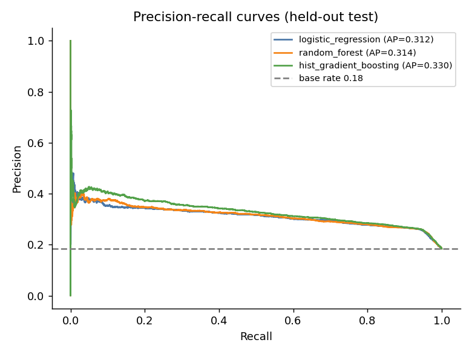
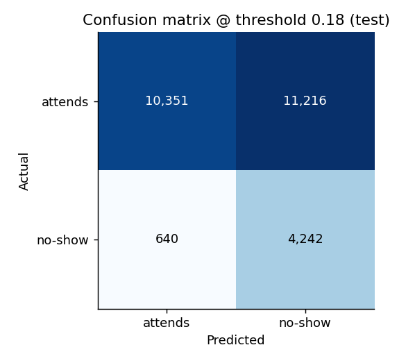
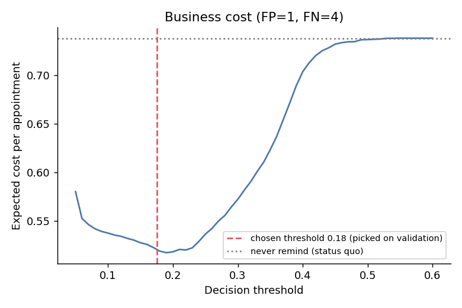
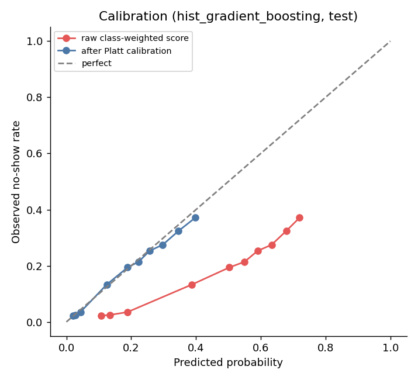
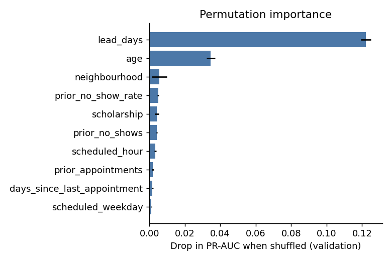

# Technical Report - Hospital Appointment No-Show Prediction

*AI & Machine Learning assessment · decision-support MVP · every number comes from `reports/metrics.json`, produced by `python -m noshow.train` on the real Kaggle dataset.*

## 1. Problem framing

| Item | Definition |
|---|---|
| Business decision | Choose which booked appointments receive a **human-reviewed** reminder call/SMS, and where to hold scheduling buffers |
| Prediction unit | One scheduled appointment |
| Prediction time | **When the appointment is booked.** Nothing that happens after booking may be used |
| Horizon | Appointment date, 0-179 days later |
| Target | `no_show` = 1 if the patient did not attend |
| Out of scope | Diagnosis, urgency, clinical outcomes, any decision to cancel/deprioritise a patient |

**Business cost.** A *false positive* is an unnecessary reminder (staff time, patient annoyance) - assumed cost **1**. A *false negative* is an unreminded no-show - an empty clinic slot nobody else could use - assumed cost **4** (illustrative; the hospital should substitute real figures in `config.py`). Reminding is worthwhile when P(no-show) > 1/(1+4) = **0.20**, the theoretical threshold the learned operating point is checked against.

## 2. Data

### 2.1 Source
**Kaggle "Medical Appointment No Shows"** (user *joniarroba*, `noshowappointments`; file `KaggleV2-May-2016.csv`): 110,527 appointments from public hospitals in Vitória, Brazil, booked and attended 29 Apr - 8 Jun 2016, de-identified. Licence: as stated on the dataset page (non-commercial share-alike; verify before redistributing - the raw CSV is therefore **not** committed to the repository; download it into `data/raw/`). A schema-identical synthetic generator (`src/noshow/data_generator.py`) is included so the pipeline can also be reproduced without a Kaggle account.

### 2.2 Quality checks and cleaning (`data/processed/data_quality_report.json`)
| Check | Result |
|---|---|
| Rows raw -> clean | 110,527 -> 110,516 |
| Unique patients | 62,296 |
| Missing values | none in raw columns (history features are legitimately missing for first-time patients -> `has_history` flag + median imputation) |
| Duplicate appointment IDs | 0 |
| Age < 0 or > 110 | 6 removed |
| Appointment date before booking date | 5 removed |
| Outliers | numeric inputs winsorised at the 0.1 % / 99.9 % training quantiles inside the model pipeline |
| Rare neighbourhoods | grouped as "infrequent" (< 150 training rows) by the encoder |
| Class balance | 20.2 % no-show (~1 : 4) |

### 2.3 EDA findings
* **Booking lead time is the dominant signal.** Same-day bookings no-show ~5 %; anything booked ahead runs 23-33 %.
* About **34 % of all appointments are same-day** bookings, so "same-day vs booked ahead" alone carries much of the predictive power.
* Young adults (18-34) miss most (22 %); over-65s least. Weekday effects are small.
* Neighbourhood and welfare-scholarship (a social-support programme flag) shift the base rate modestly; patient history is weak because the data covers only six weeks.
* Raw `SMS_received = 1` rows no-show *more* (27.6 % vs 16.7 %). That is confounding, not harm from SMS: SMS is only sent for longer lead times. It is also a post-booking intervention, so it is excluded (§4).

## 3. Features (all known at booking time)
| Feature | Type | Notes |
|---|---|---|
| `lead_days`, `log_lead_days`, `same_day` | numeric / flag | appointment date - booking date |
| `age` | numeric | validated 0-110 |
| `scheduled_hour`, `scheduled_weekday`, `appointment_weekday` | numeric / categorical | calendar |
| `neighbourhood` | categorical | rare levels grouped |
| `scholarship` | flag | socio-economic proxy -> audited (§7) |
| `prior_appointments`, `prior_no_shows`, `prior_no_show_rate`, `days_since_last_appointment`, `has_history` | numeric / flag | **only appointments whose date is strictly before the booking date**, i.e. outcomes already known |

## 4. Leakage and sensitive-data analysis (acceptance test 5)
| Risk | Treatment | Evidence |
|---|---|---|
| Clinical / sensitive variables (`Hipertension`, `Diabetes`, `Alcoholism`, `Handcap`) | dropped on load, never modelled | `test_sensitive_and_post_booking_columns_are_dropped`, `test_model_features_contain_no_forbidden_columns` |
| `SMS_received` (sent after booking) | dropped: not available at prediction time | same tests; EDA note above |
| Patient history peeking into the future | counts use only appointments dated before the booking day | `test_history_features_only_use_outcomes_known_at_booking_time` and a **time-travel test**: flipping a later appointment's outcome changes no earlier row's features |
| Random split leaking time | chronological split by appointment day; a day never straddles two sets | `test_real_dataset_split_is_chronological_and_leak_free` (runs on the real data) |
| Identifiers | `patient_id` / `appointment_id` never used as features | feature-list test |
| Gender | kept only for the fairness audit | not in `FEATURES` |
| Statistical smell test | highest single-feature AUC on train is 0.700 (`lead_days`); nothing near 0.9+ | `reports/eda_summary.json` |

## 5. Validation strategy
Chronological split by appointment date (never shuffled), so the test set mimics deploying on future bookings:

| Split | Appointment dates | Rows | No-show rate |
|---|---|---|---|
| Train | 29 Apr - 19 May | 63,529 | 20.9 % |
| Validation | 20 - 31 May | 20,538 | 20.1 % |
| **Test (untouched)** | 1 - 8 Jun | 26,449 | **18.5 %** |

* Hyper-parameters (3 settings per model) and the **model choice** use **validation PR-AUC only**.
* The probability calibrator and the operating threshold are fitted on validation.
* The test set is scored once, at the end.
* The test period's no-show rate (18.5 %) is lower than train (20.9 %): a mild real-world drift that a random split would have hidden. Calibration still holds (mean predicted 19.3 % vs observed 18.5 %).

## 6. Models and results (held-out test, 26,449 appointments, 4,882 no-shows)

**Imbalance handling:** balanced class weights for all learners; because that distorts probabilities, a Platt (logistic) calibrator is fitted afterwards and the threshold is chosen on cost, not 0.5.

Comparison at a common rule - threshold = max-F1 on validation:

| Model | Precision | Recall | F1 | ROC-AUC | PR-AUC | Cost / appt |
|---|---|---|---|---|---|---|
| Baseline: never flag (status quo) | 0.000 | 0.000 | 0.000 | 0.500 | 0.185 | 0.738 |
| Baseline: remind everyone | 0.185 | 1.000 | 0.312 | 0.500 | 0.185 | 0.815 |
| Baseline: rule "not same-day" (`lead_days >= 1`) | 0.260 | 0.924 | 0.406 | 0.691 | 0.282 | 0.542 |
| Logistic regression | 0.281 | 0.775 | 0.413 | 0.717 | 0.312 | 0.532 |
| Random forest | 0.293 | 0.669 | 0.408 | 0.719 | 0.314 | 0.542 |
| **Hist. gradient boosting** | **0.303** | 0.688 | **0.421** | **0.729** | **0.330** | **0.522** |

**Selected model: histogram gradient boosting** (best validation PR-AUC 0.357; also best on test, so the choice is not a validation fluke). Differences between learners are small (ROC-AUC 0.717-0.729): booking-time data holds limited signal, and extra model capacity buys only a little.

### 6.1 Operating point (calibrated, cost-based threshold = 0.175, chosen on validation)
| Precision | Recall | F1 | Flag rate | TP | FP | FN | TN |
|---|---|---|---|---|---|---|---|
| 0.274 | 0.869 | 0.417 | 58.4 % | 4,242 | 11,216 | 640 | 10,351 |

**Cost per appointment** (FP = 1, FN = 4): model **0.521** vs never-remind 0.738 (**-29 %**), remind-everyone 0.815 (**-36 %**), single "not same-day" rule 0.542 (**-4 %**). The test cost curve is flat around the chosen threshold (≈0.518 at 0.20 among the swept values), so the validation-picked 0.175 is near-optimal rather than over-tuned.

Capacity-constrained view (call only the top-k % riskiest): top 5 % -> precision 0.40 (lift 2.2x); top 10 % -> 0.37 (2.0x); top 20 % -> 0.35 (1.9x); top 30 % -> 0.32 (1.8x).

| Threshold | Precision | Recall | Flag rate | Cost / appt |
|---|---|---|---|---|
| 0.10 | 0.260 | 0.946 | 67 % | 0.537 |
| 0.15 | 0.267 | 0.913 | 63 % | 0.528 |
| **0.20** | 0.285 | 0.802 | 52 % | **0.518** |
| 0.25 | 0.310 | 0.616 | 37 % | 0.536 |
| 0.30 | 0.336 | 0.444 | 24 % | 0.572 |
| 0.40 | 0.419 | 0.072 | 3 % | 0.704 |
| 0.50 | 0.545 | 0.003 | 0.1 % | 0.737 |

The trade-off is explicit: higher thresholds make flags more accurate but miss most no-shows; with a 4:1 cost ratio the cost-optimal point deliberately accepts low precision.

### 6.2 Calibration
The raw class-weighted score badly overstates risk (Brier 0.216); after Platt calibration predicted probabilities match observed rates (**Brier 0.136**, better than the constant-prior reference 0.151). Staff can read "44 %" as "about 44 in 100 similar bookings no-show". Isotonic calibration was tried first and rejected: it is a step function, which made per-prediction explanations jump ~10 points for irrelevant inputs.

## 7. Explainability, error analysis, fairness

**Global drivers** (permutation importance, validation): booking lead time (by far), then age; neighbourhood, past no-show rate and scholarship contribute little.

**Local explanation (acceptance test 4).** `POST /predict` for a 24-year-old in JARDIM CAMBURI, booked 19 days ahead, 3 past appointments (2 no-shows), no scholarship, returns **43.6 %** ("high"; 35.9 % of comparable validation bookings no-showed). Top factors: booking lead time **+7.8 pp**, past attendance history **+4.2 pp**, age **+3.9 pp**; neighbourhood and booking hour ≈ 0. Each factor is computed live by resetting that input to a reference value and re-scoring with the saved model (`predict.explain_row`); the dashboard draws the same bars.

**Uncertainty.** Precision at the operating point is only 27 %: most flagged patients would have attended anyway. Even the "very high" band (≥ 45 %) had a 40 % observed no-show rate on validation (only 165 bookings, so noisy). The dashboard shows the observed rate of the score's risk band beside every probability.

**Error analysis (test, at the operating threshold).** 640 missed no-shows vs 4,242 caught:
* **43 % of misses are same-day bookings** (vs 2.4 % of caught cases; mean lead 2.3 vs 18.6 days). Same-day patients no-show only 4.1 % of the time and the model flags just 2.6 % of them. These are the hardest to predict and the hardest to act on (no time to remind).
* Missed no-shows are **older** (mean age 51 vs 32 for caught ones) - the model is biased towards catching young adults (see audit).
* False positives dominate by design: with a ~20 % base rate and ROC-AUC 0.73, 87 % recall costs 11,216 extra reminders. Acceptable only because a reminder is cheap.

**Subgroup audit (test, at operating threshold)**

| Group | n | Observed no-show | Mean predicted | Flag rate | Recall | Precision |
|---|---|---|---|---|---|---|
| Female | 17,314 | 18.3 % | 19.5 % | 59 % | 0.87 | 0.27 |
| Male | 9,135 | 18.8 % | 18.9 % | 57 % | 0.86 | 0.28 |
| 0-17 | 6,498 | 20.1 % | 21.8 % | 62 % | 0.93 | 0.30 |
| 18-34 | 5,584 | 22.3 % | 22.7 % | 65 % | 0.95 | 0.32 |
| 35-64 | 10,743 | 16.8 % | 17.7 % | 58 % | 0.85 | 0.24 |
| **65+** | 3,624 | 14.6 % | 14.0 % | 42 % | **0.59** | 0.21 |
| Scholarship = no | 23,888 | 18.2 % | 18.9 % | 58 % | 0.86 | 0.27 |
| Scholarship = yes | 2,561 | 20.9 % | 22.4 % | 61 % | 0.93 | 0.32 |

Gender parity is good and calibration holds by age (mean predicted ≈ observed). But **recall for patients 65+ is 0.59 versus 0.95 for 18-34**: older patients' no-shows are caught much less often, so a pure score-ranking gives them fewer reminders. Scholarship holders are flagged slightly more (61 % vs 58 %), so the burden of extra calls leans towards a socio-economic group. Mitigations: reminders are low-stakes and human-approved; never use scores to deny or cancel; monitor these gaps; consider a lower threshold for 65+ (equal-recall policy) if the hospital judges the gap unacceptable.

## 8. Limitations, bias, privacy, failure modes
* **Representativeness.** Six weeks in 2016, public hospitals in one Brazilian city. Seasonality, holidays, clinic type, specialty and the later COVID period are not covered; the base rate already shifted between weeks. Patient history is truncated at the start of the window (cold start) and weak overall.
* **Proxy variables.** `neighbourhood` and `scholarship` are socio-economic / location proxies that could encode inequity. They carry little signal here (importance ≈ 0.005), so the hospital may reasonably drop them; the audit above shows their effect.
* **Correlation, not causation.** The model says who is likely to miss, not that a reminder will prevent it. Benefit must be measured with a trial.
* **Drift / failure modes.** New neighbourhoods map to "infrequent" (API warns); lead times beyond training range are extrapolated (API warns); wrong history inputs give wrong scores (API validates `prior_no_shows ≤ prior_appointments`); policy changes (e.g. mandatory SMS) shift the base rate. Retrain and re-audit on a schedule.
* **Privacy.** The Kaggle data is de-identified (no names or addresses) but `PatientId` is still a linkable key; it is used only to build history features, never as a feature, and the raw file is git-ignored. Clinical variables are dropped on load. No sensitive data is stored or accepted by the API.
* **Human oversight.** Every response carries `human_review_required: true` and a disclaimer; the dashboard routes each flag through *Approve / Dismiss* by staff. The score must never be used to cancel, double-book or deprioritise care.
* **Modest edge over a trivial rule.** The model beats "flag everything that isn't same-day" by only ~4 % in cost. Its practical value over that rule is calibrated probabilities, ranking within the booked-ahead group, and explanations - not a big accuracy jump.

## 9. Reproducibility
Seeded (42) end to end; repeated runs on the same data give identical metrics. `requirements.txt` gives version ranges (Python 3.10-3.13, tested with numpy 2.2 / pandas 2.2 / scikit-learn 1.6 and with the newest versions); 22 pytest tests cover cleaning, leakage, split, artifact integrity, train/serve feature consistency, API behaviour and input validation.

## 10. Acceptance tests - where to see the evidence
| # | Test | Evidence |
|---|---|---|
| 1 | Reproduce dataset, split, training from README | README §2-3; `data_quality_report.json`; identical-metrics reruns |
| 2 | Baseline + candidate metrics on untouched test | §6 table; `metrics.json` |
| 3 | Real prediction via API/app from saved model | `POST /predict`; `test_prediction_equals_direct_artifact_call`, `test_model_is_not_a_constant...` |
| 4 | Explain one prediction/error, influential inputs, limitation | §7 |
| 5 | No leakage / sensitive data | §4 and the tests listed there |
